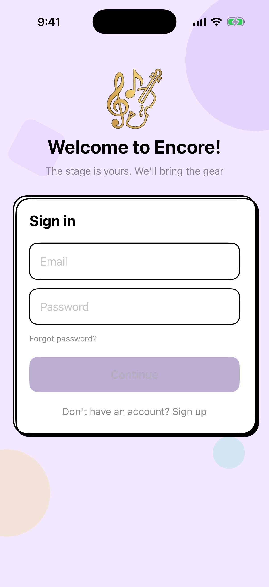

# Encore — Instrument Rental App

<p align="center"></p>

iOS app (SwiftUI, iOS 16+) for peer-to-peer musical instrument rentals. Built for Costa Rica with full English/Spanish support. Backend: Supabase (REST via URLSession, no SDK).

---

## Features

### Renter

| Feature | Description |
|---------|-------------|
| **Browse** | Browse instruments with category filters, price range, and nearby search (location-based) |
| **Instrument detail** | Photo gallery, host profile, reviews, blocked dates calendar, and "Message host" |
| **Checkout** | 4-step flow: dates → pickup method → payment → confirm. Range calendar with unavailable dates. |
| **Payment** | Save multiple cards (Visa/Mastercard/Amex). Select any saved card or enter new one at checkout. |
| **My Rentals** | Active bookings (pending, confirmed, active) and past rentals. Tap for full details. Instrument photos on cards. |
| **Favorites** | Save instruments for quick access later |
| **Messages** | Chat with hosts. Instrument thumbnail and name in list and chat header. |
| **Reviews** | Rate instruments after completion. View and write host/renter reviews. |
| **Profile** | Edit profile, avatar, location (city + country), phone. View My Reviews. |

### Host

| Feature | Description |
|---------|-------------|
| **Dashboard** | Earnings summary, pending bookings card (tappable → Reservations), recent activity |
| **Listings** | Add, edit, delete instruments. Toggle availability. Photo upload with emoji fallback. |
| **Reservations** | Pending / Active / Past tabs. Approve or decline pending. View rental details. |
| **Messages** | Chat with renters. Instrument context in conversations. |
| **Profile** | Same as renter; switch to hosting mode from profile. |

### Shared

| Feature | Description |
|---------|-------------|
| **Bilingual** | Full EN/ES throughout. Language persisted in settings. |
| **Theme** | Light / dark / system appearance toggle |
| **Profile** | Avatar upload, location detection, country picker, phone with country dial code |
| **Privacy** | Toggle visibility of phone and location on profile |
| **Legal** | Terms of Service and Privacy Policy |

---

## Setup

### 1. Open in Xcode

1. Open **`Encore.xcodeproj`** in Xcode.
2. Select the **Encore** scheme and a simulator or device.
3. Press **⌘R** to run.

### 2. Supabase

1. Create a project at [Supabase](https://supabase.com).
2. Run the SQL migrations in the Supabase SQL Editor (in order):
   - **supabase/Supabase_Setup.sql** — Core tables: `users`, `instruments`, `rentals`, `reviews`, `favorites`
   - **supabase/Supabase_Messaging.sql** — `conversations`, `messages`
   - **supabase/Supabase_PaymentMethods.sql** — `payment_methods`
   - **supabase/Supabase_UserReviews.sql** — `user_reviews`
   - **supabase/Supabase_AddLocationColumns.sql** — `latitude`, `longitude` on users
   - **supabase/Supabase_AddCountryIso.sql** — `country_iso` on users
   - **supabase/Supabase_Profile_Photo_LastName.sql** — Profile fields
   - **supabase/Supabase_AllFixes.sql** — RLS policies and fixes
3. Create storage buckets: **`avatars`** and **`instrument-photos`** (set to Public).
4. Add your project's credentials (the file is git-ignored):
   ```bash
   cp Config/Secrets.example.xcconfig Config/Secrets.xcconfig
   ```
   Then set `SUPABASE_HOST` (e.g. `abcd1234.supabase.co`, without `https://`) and `SUPABASE_ANON_KEY` (Settings → API).

---

## Testing

### Unit & Integration Tests

1. Open the project in Xcode.
2. Select the **Encore** scheme.
3. Press **⌘U** to run all tests.

Tests cover: models (Codable, `displayName`), checkout helpers (card brand, formatting), `CountryDialCode`, `LocationChipView`, `Color(hex:)`, and `SupabaseClient` (with mocked network).

### Testing Reviews

Reviews are only available **after a rental is completed**. You can test them in two ways:

**Option A: Use seed data**

1. Run **supabase/Supabase_SeedData.sql** in the Supabase SQL Editor (after migrations).
2. Sign in with a demo account (password: `Encore123!`):
   - **diego.ramirez@demo.com** (renter) — has a completed rental (Violín 4/4 Mendini) that hasn’t been reviewed yet.
   - **sofia.vargas@demo.com** (host) — can review Diego for that same rental.
3. As **Diego**: My Rentals → tap the Violín rental → use **Rate** (instrument review) and **Review Host** (user review).
4. As **Sofia**: Reservations → Past tab → tap the Violín rental → use **Review Renter**.

**Option B: Full flow**

1. Create a renter account, browse, and complete a booking.
2. As host, approve the booking.
3. Manually set the rental to `completed` in Supabase (or wait for your app’s completion logic).
4. As renter, open My Rentals → tap the rental → leave instrument and host reviews.
5. As host, open Reservations → Past → leave renter review.

---

## Project Structure

```
Encore/
├── App/                EncoreApp, AuthManager, LanguageManager, ThemeManager
├── Network/            SupabaseClient, StorageService, ListingsCache
├── Helpers/            CheckoutHelpers (card brand, formatting)
├── Models/             Models.swift (AppUser, Instrument, Rental, Review, UserReview,
│                       Conversation, Message, PaymentMethodRow, etc.)
├── Views/
│   ├── Auth/           AuthView (sign in, sign up, role selection)
│   ├── Renter/         BrowseView, InstrumentDetailView, CheckoutView,
│   │                   MyRentalsView, RentalDetailView, FavoritesView, RenterProfileView
│   ├── Host/           HostDashboardView, HostListingsView, HostBookingsView,
│   │                   AddInstrumentView, EditInstrumentView, HostProfileView,
│   │                   HostInsightsPlaceholderView
│   └── Shared/         MessagesView, ConversationView, EditProfileView,
│                       LocationChipView, CountryCodePickerView,
│                       UserReviewsListView, UserReviewFormView, RatingsView,
│                       ReviewsListView, HelpView, PrivacySettingsView, LegalView,
│                       MemphisIllustrations, ToastView
├── Extensions/         Extensions.swift (design system, MemphisCardModifier, colors)
└── Resources/         Strings.swift (EN/ES), Assets
```

---

## Design System — Corporate Memphis

See **[DESIGN.md](./docs/DESIGN.md)** for full rationale.

| Token | Value | Role |
|-------|-------|------|
| `encorePrimary` | `#7C3AED` | Primary purple — buttons, active states |
| `encoreAccent` | `#FCD34D` | Yellow — badges, stars, highlights |
| `encoreFrame` | `#F2E8FF` | Soft lavender — page background |
| `encorePink` | `#EC4899` | Pink — favorites, accents |
| `encoreGreen` | `#34D399` | Green — availability, success |
| `encoreBlue` | `#60A5FA` | Blue — confirmed status |
| `encoreCoral` | `#F87171` | Red/coral — destructive, cancelled |
| `encoreOrange` | `#FB923C` | Orange — pending, location |

- Flat solid fills, no gradients
- Black outlines (1.5–2pt) on interactive elements
- Hard offset shadows (no blur)
- Bold typography, geometric decorative shapes

---

## Docs

| File | Description |
|------|-------------|
| **[TESTING_PLAN.md](./docs/TESTING_PLAN.md)** | Testing strategy, unit/integration scope, and edge cases |
| **[DESIGN.md](./docs/DESIGN.md)** | Corporate Memphis design rationale and system |
| **[PLAN.md](./docs/PLAN.md)** | Original architecture plan and DB schema |
| **[DEVNOTES.md](./docs/DEVNOTES.md)** | Implementation notes and gotchas |
| **[CLAUDE_CONTEXT.md](./docs/CLAUDE_CONTEXT.md)** | Troubleshooting context for profile/listings issues |
